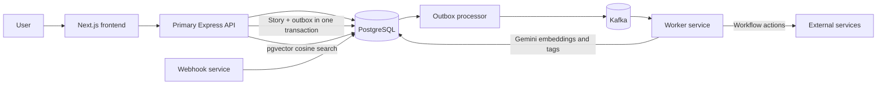

<div align="center">

# ⚡ FlowFuse

### A visual workflow builder backed by an event-driven services architecture

Create webhook-triggered workflows, connect ordered actions, and process work asynchronously. FlowFuse is a TypeScript portfolio project demonstrating workflow orchestration, a transactional outbox, Kafka-based processing, and multilingual story search.


</div>

---

## What FlowFuse does

- **Build workflows:** Configure a Track with a trigger and an ordered list of actions in the Next.js interface.
- **Accept webhook events:** The webhook service records workflow runs and outbox entries in PostgreSQL.
- **Process asynchronously:** A relay publishes outbox events to Kafka, and workers execute actions and advance workflow stages.
- **Find related stories:** Create English or Hindi stories, enrich them with Gemini embeddings, and retrieve semantically similar stories from PostgreSQL with pgvector.

> FlowFuse is a project prototype. Email is the implemented workflow action; meeting and calendar integrations and production operations need further work. Run it in a development environment and configure external services before using those paths.

## Architecture



The outbox makes story creation and the intent to publish `story.created` atomic. The processor sends that event through the existing `track-events` topic. The worker generates a normalized 768-dimensional embedding and stores it with enrichment metadata. Similarity search uses pgvector cosine distance and an HNSW index. Enrichment retries use bounded exponential delays; after five attempts, the event is sent to `story-enrichment-dlq`.

## Repository map

| Directory | Responsibility |
| --- | --- |
| `frontend/` | Next.js workflow builder and user interface |
| `primary-backend/` | Express API, Prisma schema, story API and database migrations |
| `webhooks/` | Incoming webhook service |
| `processor/` | PostgreSQL outbox relay to Kafka |
| `worker/` | Kafka consumers, workflow actions and story enrichment |

## Requirements

- Node.js 18 or newer and npm
- PostgreSQL
- Apache Kafka
- A Gemini API key for story enrichment ([Google AI Studio](https://aistudio.google.com/app/apikey))

Each service has its own `package.json` and dependencies. Configure the service `.env` files with the appropriate `DATABASE_URL`; set `GEMINI_API_KEY` for the worker. `KAFKA_BROKERS` is a comma-separated broker list and defaults to `localhost:9092` in the processor and worker.

## Run locally

Start PostgreSQL and Kafka first, then install dependencies and generate each Prisma client:

```bash
cd primary-backend && npm install && npx prisma generate && npx prisma migrate deploy
cd ../processor && npm install && npx prisma generate
cd ../worker && npm install && npx prisma generate
cd ../webhooks && npm install && npx prisma generate
cd ../frontend && npm install
```

The story migration enables PostgreSQL's `vector` extension. The database role must have permission to enable it, or the extension must be provisioned by a database administrator.

Run each service in its own terminal. The backend and frontend defaults would both use port 3000, so start the frontend on the port already allowed by the backend's local CORS configuration:

```bash
# primary-backend/
npm start

# processor/, worker/, and webhooks/ (one terminal per service)
npm start

# frontend/
npm run dev -- -p 3002
```

The frontend is available at `http://localhost:3002`; the primary API listens on `http://localhost:3000`.

## Story API

Create a story:

```http
POST /api/v1/stories
Content-Type: application/json

{
  "title": "The Banyan Tree",
  "text": "A village ...",
  "language": "en",
  "genre": "folk-tale"
}
```

Find the nearest enriched stories (default `k=5`, maximum `20`):

```http
GET /api/v1/stories/{id}/similar?k=5
```

The search excludes the source story and returns cosine similarity scores. If enrichment is still in progress, the endpoint responds with `202`; if enrichment exhausted its retries, it responds with `503` and the event is available in the dead-letter topic.

Seed 200 original demo stories split across English and Hindi. Each seeded story enters the same outbox and enrichment pipeline:

```bash
cd primary-backend
npm run seed:stories
```

## Configuration

| Variable | Service | Default | Purpose |
| --- | --- | --- | --- |
| `DATABASE_URL` | Backend, processor, worker, webhooks | — | PostgreSQL connection string |
| `GEMINI_API_KEY` | Worker | — | Gemini embedding API key |
| `GEMINI_EMBEDDING_MODEL` | Worker | `gemini-embedding-001` | Embedding model name |
| `KAFKA_BROKERS` | Processor, worker | `localhost:9092` | Comma-separated Kafka broker addresses |

Gemini's embedding models support multilingual semantic search. The selected 768-dimensional output is normalized before storage so cosine distance compares vector direction consistently. See [Gemini embeddings documentation](https://ai.google.dev/gemini-api/docs/embeddings) for model and language details.

## Development status

FlowFuse demonstrates the end-to-end architecture, but performance and recommendation quality have not been benchmarked against a running deployment. Measure query latency and inspect top-k relevance on the target database and corpus before making throughput or accuracy claims. Operational work such as authenticated webhook signatures, idempotent external side effects, observability, deployment configuration, and broader integration coverage remains suitable follow-up work.

## License

ISC. See the individual service manifests for package metadata.
