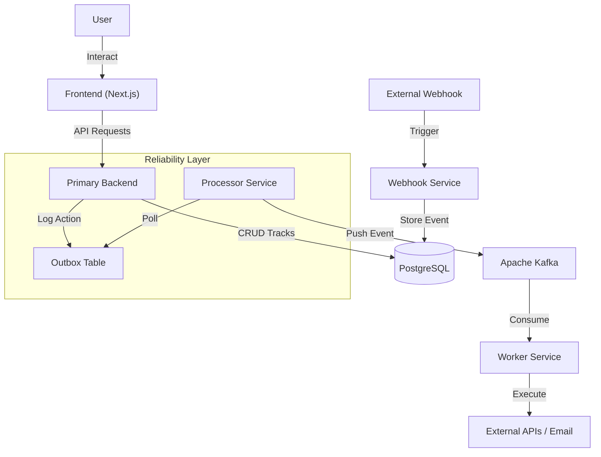

# ⚡ FlowFuse

**FlowFuse** is a scalable, open-source workflow automation platform designed to integrate seamlessly with your favorite apps. Built as a high-performance alternative to Zapier, FlowFuse enables users to create automated workflows (Tracks) using a visual interface, powered by a robust, event-driven microservices architecture.

---

## 🚀 Features

- **Visual Workflow Builder**: Create deeply customizable automation tracks with an intuitive frontend.
- **Microservices Architecture**: Decoupled services for maximum scalability and maintainability.
- **Reliable Execution**: Implements the **Transactional Outbox Pattern** to ensure no event is lost during database-to-queue handovers.
- **Scalable Processing**: Powered by **Apache Kafka** to handle high-throughput event streaming.
- **Secure & Robust**: Built with modern best practices, including JWT authentication and secure webhook handling.

---

## 🏗️ Architecture

FlowFuse utilizes a distributed system design to ensure reliability and performance.



### Components

1.  **Frontend (`/frontend`)**:
    -   Built with **Next.js 15**, **React 19**, and **Tailwind CSS**.
    -   Provides the UI for users to sign up, manage dashboard, and configure "Tracks" (automation workflows).

2.  **Primary Backend (`/primary-backend`)**:
    -   **Node.js/Express** REST API.
    -   Manages user authentication, track configurations, and defining triggers/actions.
    -   Uses **Prisma** with **PostgreSQL** for data persistence.

3.  **Webhook Service (`/webhooks`)**:
    -   Standalone service to ingest incoming webhooks from third-party services.
    -   Trigger entry points for automation flows.

4.  **Processor Service (`/processor`)**:
    -   Background service ensuring data consistency.
    -   Polls the database **Outbox** table and executes reliable publishing to **Kafka**.
    -    Prevents race conditions and dual-write issues.

5.  **Worker Service (`/worker`)**:
    -   Consumes messages from **Kafka**.
    -   Executes the actual logic (e.g., sending an email via Nodemailer, utilizing SolAPI, etc.).

---

## 🛠️ Tech Stack

-   **Languages**: TypeScript
-   **Frontend**: Next.js, React, Lucide React, Tailwind CSS
-   **Backend**: Node.js, Express.js
-   **Database**: PostgreSQL, Prisma ORM
-   **Message Broker**: Apache Kafka
-   **Validation**: Zod
-   **Authentication**: JWT (JSON Web Tokens)

---

## 🏁 Getting Started

### Prerequisites

Ensure you have the following installed:
-   **Node.js** (v18 or higher)
-   **PostgreSQL**
-   **Apache Kafka** (running locally or via Docker)
-   **npm** or **yarn**

### Installation

Since FlowFuse is a mono-repo structure, you will need to set up each service individually.

#### 1. Database Setup
Ensure your PostgreSQL database is running. Update the `DATABASE_URL` in the `.env` files of backend services.

#### 2. Primary Backend
```bash
cd primary-backend
npm install
npx prisma migrate dev
npm start
```

#### 3. Webhook Service
```bash
cd webhooks
npm install
npx prisma generate
npm start
```

#### 4. Processor Service
```bash
cd processor
npm install
npx prisma generate
npm start
```

#### 5. Worker Service
```bash
cd worker
npm install
npx prisma generate
npm start
```

#### 6. Frontend
```bash
cd frontend
npm install
npm run dev
```

The frontend will be available at `http://localhost:3000`.

---

## 🤝 Contributing

Contributions are welcome! Please fork the repository and submit a pull request for any enhancements or bug fixes.

1.  Fork the Project
2.  Create your Feature Branch (`git checkout -b feature/AmazingFeature`)
3.  Commit your Changes (`git commit -m 'Add some AmazingFeature'`)
4.  Push to the Branch (`git push origin feature/AmazingFeature`)
5.  Open a Pull Request

---

## 📄 License

Distributed under the ISC License. See `package.json` in individual services for more information.
